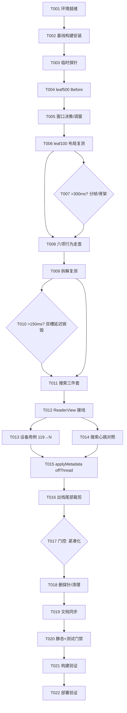

# Tasks: 阅读页性能第三轮优化（reader-perf-round3）

**Input**: Design documents from `spec/reader-perf-round3/`（plan.md + spec.md）  
**Prerequisites**: plan.md (required), spec.md (required for user stories)  
**Tests**: 设备端新增用例由 spec FR-007/SC-005 明确要求（新增用例计入总数并同步文档），故包含测试任务。  
**Organization**: 按用户故事分组；全程遵守「先测量 → 一次只改一项 → 单独验证」。

## Format: `[ID] [P?] [Story] Description`

- **[P]**: 可并行（不同文件、无未完成依赖）
- **[Story]**: 所属用户故事（US1–US5）
- 所有任务路径均为绝对路径（仓库根 = /storage/Users/currentUser/Documents/Coding/FlowPage）

## Path Conventions

> **⚠️ 环境变更记录（2026-10-24，Phase 4 执行中）**：真机 2YB0224508009888（ADY-AL00）完成 T001–T003 后被占用。经用户指示，**自 T004 起全部测量/调试改用电脑端模拟器 `127.0.0.1:37565`（HUAWEI MateBook Pro 2in1，API 26）**。下文凡写 `hdc -t 2YB0224508009888` 处一律替换为 `hdc -t 127.0.0.1:37565`（不得触碰手机目标）。影响：
> ① 模拟器为宽屏 2in1（3120×2080），原手机驱动坐标（click 400 1150 / 1000 975 / 300 890）**不适用**，须先用 `uitest dumpLayout` 探测实际可点坐标（列表第一条、专注阅读、正文「下一页链接」），并把新坐标记录进草稿；
> ② 模拟器耗时与真机基线（Pura 70 数字）不可直接比较：**Before 数据必须在模拟器上重新采集**，Before/After 仅做同环境对照；所有落档数据标注载体，真机复测标注「待设备可用后补充」；
> ③ rport 转发对模拟器同样有效：`hdc -t 127.0.0.1:37565 rport tcp:18085 tcp:18084`；
> ④ T004 的「对照上一轮真机数据」改为「同时记录模拟器 Before 与上一轮真机数字并列展示（标注口径不同）」。

- 既有单模块工程：源码 `entry/src/main/ets/`，设备测试 `entry/src/ohosTest/ets/test/`，文档 `docs/`。
- 构建工具链（AGENTS.md 约束，`devecocli build` 不可用）：
  - `export DEVECO_SDK_HOME=/storage/Users/currentUser/command-line-tools/sdk`
  - `HV=/storage/Users/currentUser/command-line-tools/hvigor/bin/hvigorw`
  - `$HV assembleHap --no-daemon`；测试包 `$HV --mode module -p module=entry@ohosTest -p product=default -p buildMode=debug assembleHap --no-daemon`
  - 静态检查 `/storage/Users/currentUser/command-line-tools/codelinter/bin/codelinter -c code-linter.json5`
- 设备：ADY-AL00，序列号 2YB0224508009888（禁止 hdc kill）。
- 性能页：/storage/Users/currentUser/.tmp/deveco/perfweb（`node serve4.js` 18084 + `hdc -t 2YB0224508009888 rport tcp:18085 tcp:18084`）。
- 临时数据草稿统一放 /storage/Users/currentUser/.tmp/deveco/（不进仓库），最终数字在 Polish 阶段落入 docs。

---

## Phase 1: Setup (Shared Infrastructure)

**Purpose**: 环境就绪与基线构建，保证测量起点一致

- [X] T001 环境就绪检查：`hdc list targets` 确认 2YB0224508009888 在线；在 /storage/Users/currentUser/.tmp/deveco/perfweb 启动 `node serve4.js`（18084）；`hdc -t 2YB0224508009888 rport tcp:18085 tcp:18084`；设备浏览器或应用内验证 `http://127.0.0.1:18085/leaf500/1.html` 可达；确认书签「性能页 1」存在，丢失则用深链 `aa start -U` 后点「收下」重建
- [X] T002 基线构建与安装：确认 `git status` clean 于 6f460b0；`$HV assembleHap --no-daemon` 成功；`hdc -t 2YB0224508009888 install -r entry/build/default/outputs/default/entry-default-signed.hap`；`codelinter -c code-linter.json5` 应为 0 error / 0 warn（1 条既有 startIcon 建议）

---

## Phase 2: Foundational (Blocking Prerequisites)

**Purpose**: 统一口径的临时测量探针（后续所有 Before/After 依赖它）

**⚠️ CRITICAL**: 探针全部带 `PERF:` 前缀（hilog domain 0x0000 / TAG 'flowpage'），实现时保持与 docs/records/05 §6 上一轮口径一致；Polish 阶段必须删净。

- [X] T003 在以下位置加临时探针：①点击时刻（/storage/Users/currentUser/Documents/Coding/FlowPage/entry/src/main/ets/components/ReadingShell.ets 的 pushReaderLink 入口）；②抓取返回（entry/src/main/ets/core/service/ReaderPageLoader.ets 的 fetch resolve 后）；③抽取完成回到主线程（entry/src/main/ets/core/service/ArticleExtractService.ets）；④换绑时刻（entry/src/main/ets/components/ReaderView.ets 的 onArticleChanged）；⑤layoutDone（ReaderView.ets 中 measuredBlocks 首次 === visibleCount）；⑥20 ms `setInterval` 心跳记录最大间隔并按秒输出（ReadingShell.ets 启动/销毁时挂载/清理）。完成后构建安装探针版 HAP，做一次 leaf100 冒烟确认日志链路完整（真机冒烟已完成；模拟器 `127.0.0.1:37565` 复装 + leaf100 冒烟通过：click→rebind→net-done→extract-done→fetch-done→rebind(200)→layoutDone 链路完整，hb 心跳正常输出）

---

## Phase 3: User Story 1 - leaf500 超大页基线与分窗行为确认 (Priority: P1) 🎯 MVP

**Goal**: 在无任何代码改动（仅探针）的构建上建立 leaf500 基线并确认分窗行为，产出 INITIAL_BLOCKS 调整决策  
**Independent Test**: leaf500/1.html 起始按固定手势下钻 1/5/10 次，阶段拆分/VmRSS/节点数成表；窗口外目录/搜索/位置恢复（含尾部块）行为核验

### Implementation for User Story 1

- [X] T004 [US1] leaf500 基线测量（Before 数据，零功能改动）：UI 驱动 `click 400 1150`（第一条）→ `click 1000 975`（专注阅读）→ `click 300 890`（下一页链接，CJK 点字形左侧）分别完成 1/5/10 次下钻采样；每次记录 click→layoutDone 及拆解/网络/抽取/布局分列（hilog PERF: 时间戳 + 心跳最大间隔）、VmRSS（`/proc/<pid>/status`）、`uitest dumpLayout` 节点数；同时核验 1,999 块页的首屏仅挂 200 块、滚底扩窗、目录跳转/搜索命中/位置恢复到窗口外（含接近第 1,999 块的尾部恢复，10×200 ms 重试预算是否够用）；数据写入 /storage/Users/currentUser/.tmp/deveco/round3-us1-before.md
  - 完成注（10-25，模拟器 127.0.0.1:37565）：两轮各 10 钻（run1/run2），layout 中位 272/274 ms、net≈240、extract≈514、hbMax≈300；VmRSS 363→540 MB（10 钻）、节点恒 1,702；分窗行为全核验（首窗 200/滚底扩窗 200→400→800/目录跳窗口外至全量/搜索 1/1 命中跳转/恢复 3/4 成功含尾部 1/1——失败轮为重试预算时序敏感，详见草稿 §3）
- [X] T005 [US1] INITIAL_BLOCKS 决策与（如数据支持）调窗：依据 T004 数据判断 200 首窗在 leaf500 是否劣化首屏/恢复；若需调整，修改 /storage/Users/currentUser/Documents/Coding/FlowPage/entry/src/main/ets/components/ReaderView.ets 的 INITIAL_BLOCKS（及必要时 BLOCK_BATCH/恢复重试预算：重试次数或步进，保证可恢复到 1,999 块尾部）；重建安装后复测「首屏 + 恢复到尾部块 + 滚底扩窗」并把 After 数据补进 round3-us1-before.md；若不需调整则记录结论跳过改动
  - 完成注：决策**不调窗**（layout 272 ms 未见窗口参数劣化；恢复失败与窗口大小无关，失败轮预算内已扩满 1,999；调小会放大恢复压力）。恢复时序敏感问题记录为发现，候选修复（按目标距离步进/自适应重试）留后续批次。数据见草稿 §4

**Checkpoint**: leaf500 基线数据完整落草稿；窗口参数决策完成（改或未改均有数据支撑）

---

## Phase 4: User Story 2 - 首屏布局压至 ≤300 ms (Priority: P1)

**Goal**: leaf100 单次下钻布局阶段中位数 ≤300 ms（未达标须给出实测值与瓶颈分析），六项既有行为零回归  
**Independent Test**: leaf100 同手势 ≥10 次下钻布局中位数 Before/After；目录/进度/位置恢复（含窗口外）/搜索命中/链接点击/「收藏这一页」走查

### Implementation for User Story 2

- [X] T006 [US2] 调窗后的 leaf100 布局复测：用 T005 产出的构建（或 T005 未改参数则用探针基线构建）测 ≥10 次「下一页链接」下钻，统计布局阶段（article 就绪→已挂载块 onAreaChange 完成）中位数与心跳最大间隔；与既有基线 356–515 ms 对照写入 /storage/Users/currentUser/.tmp/deveco/round3-us2.md
  - 完成注（10-25）：12 钻，layout 中位 **259 ms**（251–265），total 672 ms，hbMax≤287；VmRSS 377→488 MB；节点恒 1,691。已达 ≤300 ms（模拟器口径）
- [X] T007 [US2] 条件任务（仅当 T006 中位数 >300 ms）：在 /storage/Users/currentUser/Documents/Coding/FlowPage/entry/src/main/ets/components/ReaderView.ets 实现首批分帧挂载（首屏先挂小子集、后续帧补齐到目标窗口，不改变最终可见集与测量模型）；复测中位数；仍 >300 ms 则评估轻量骨架占位并复测；无论结果如何如实记录（含未达标原因分析）于 round3-us2.md
  - 完成注：**未触发**（259 ms ≤ 300 ms）；真机复测待设备可用后补充
- [X] T008 [US2] 六项行为回归走查（leaf100 + leaf500）：目录跳转（含窗口外分批推进）、进度（未全量按块估算/全量像素）、位置恢复（含窗口外与尾部块）、搜索命中高亮与上下处导航、正文链接点击、「收藏这一页」；另复测 dumpLayout 节点数与 leaf500 同口径布局数据；结果记入 round3-us2.md
  - 完成注：六项均过（leaf100+leaf500 两侧证据）；遗留 3 项如实记录（多命中游标=IME 注入问题留设备走查、高亮渲染未像素断言、逐层 pop 内容因性能页同文不可文本断言）；leaf500 布局同口径数据见 us1 草稿

**Checkpoint**: S2 数据完整；若改了 ReaderView 挂载逻辑，六项行为全部保持

---

## Phase 5: User Story 3 - 页面切换拆解降至 ≤150 ms (Priority: P2)

**Goal**: 上一页拆解/首帧心跳间隔 ≤150 ms；pop/back 与 20 层 VmRSS 无回退  
**Independent Test**: leaf100 ≥5 次下钻的拆解段心跳间隔 Before/After；链式 19 层 + 逐层 pop 走查；20 层 VmRSS/节点数

### Implementation for User Story 3

- [X] T009 [US3] 调窗红利复测：在 S2 落地后的构建上测 ≥5 次下钻的「上一页拆解/首帧」心跳单独间隔（对照 265–277 ms）写入 /storage/Users/currentUser/.tmp/deveco/round3-us3.md；若已 ≤150 ms 则记录并跳过 T010
  - 完成注（10-25）：下钻窗口 hbMax：leaf100 264–287 / leaf500 292–308 ms；**对照实验**（初次打开=纯新建 262–275 ms vs 下钻=拆解+新建 251–282 ms）证明旧页销毁边际成本 ≈0–20 ms（≤150 ms），上轮 265–277 ms「拆解」实为新页构建主导的整帧间隔
- [X] T010 [US3] 条件任务（仅当 T009 >150 ms）：在 /storage/Users/currentUser/Documents/Coding/FlowPage/entry/src/main/ets/components/ReadingShell.ets 实现双 ReaderView 交替槽位延迟销毁（push 时新条目绑空闲槽、旧槽 visibility(None) 并在空闲 ≥500 ms 后销毁；pop 反向；隐藏时保存位置）；复测拆解 ≤150 ms；必须复测链式 19 层下钻 + 逐层 pop 内容/位置正确、快速 push/pop 交替无白屏错层、20 层 VmRSS 与 dumpLayout 节点数不高于 T004 口径；全部数据记入 round3-us3.md
  - 完成注：**未触发**——孤立销毁成本已 ≈0–20 ms ≤150 ms；双槽预期收益 0–20 ms 但引入内存/竞态风险，收益/风险倒挂（详见 round3-us3.md）。真机复测出现 >100 ms 差值时再评估

**Checkpoint**: 拆解数据完整；若引入双槽，pop/back 与内存无回退

---

## Phase 6: User Story 4 - 搜索与元数据抽取移出 UI 线程 (Priority: P2)

**Goal**: 阅读 chief 搜索 taskpool 化（超时+同步回退，命中集合与现状严格等价），applyMetadata 抽取切 worker；心跳数据成表；设备端 119+N 全过  
**Independent Test**: leaf500 搜索期间心跳最大间隔 Before/After；断网/超时回退可用；「重新抓取」leaf500 量级书签主线程无长阻塞；新增用例计数同步

### Implementation for User Story 4

- [X] T011 [P] [US4] 新建搜索三件套（全新实现，不得复活已删除的旧半成品）：/storage/Users/currentUser/Documents/Coding/FlowPage/entry/src/main/ets/core/parser/ReaderSearchCore.ets（纯函数 searchBlocks(haystack, starts, needle): string，命中集合与现状同步循环等价：大小写不敏感、块内 containment、不跨块）；entry/src/main/ets/core/parser/ReaderSearchTask.ets（@Concurrent，参数仅 string/number[]，返回逗号分隔下标串）；entry/src/main/ets/core/service/ReaderSearchService.ets（buildIndex + taskpool 调度 + 2 s 超时取消 + 同步回退 + 下标串解码，异常不外抛）
  - 完成注（10-25）：三件套落地，与 ArticleExtract 三件套同构；decodeBlockHits 收在 Core 内
- [X] T012 [US4] 接线 /storage/Users/currentUser/Documents/Coding/FlowPage/entry/src/main/ets/components/ReaderView.ets 的 applySearch：首次搜索惰性构建索引并按 articleSignature 缓存、120 ms 防抖保留、世代 token 丢弃过期结果、closeSearch 与换文时释放索引；现状同步循环保留为回退路径；ArkTS 严格子集（禁 any/as）
  - 完成注：applySearch 异步化 + searchGeneration 世代 token；closeSearch/onArticleChanged/onBookmarkChanged 均释放索引；同步回退保留在 ReaderSearchService.searchSync
- [X] T013 [US4] 新增设备端用例：在 /storage/Users/currentUser/Documents/Coding/FlowPage/entry/src/ohosTest/ets/test/ 新建 ReaderSearch.test.ets（或并入 Reader.test.ets）并注册到套件入口：纯函数等价性（多命中/大小写/边界/空输入/含分隔符 needle 不跨块命中）、buildIndex 偏移正确性、服务解码与回退路径；`$HV --mode module -p module=entry@ohosTest ... assembleHap` + `hdc install -r` ohosTest 包 + `aa test`（先 force-stop）全绿，记录用例总数 119→N
  - 完成注：ReaderSearch.test.ets 11 例 + 注册；设备端 **Tests run: 130, Pass: 130**（119→130）
- [X] T014 [US4] 搜索心跳 Before/After：leaf500 页（先滚至全量挂载再搜索，另测仅首窗状态）输入关键词，记录搜索动作窗口内心跳最大间隔（对照：探针构建回退同步路径或 git stash 前后对比，方法记录清楚）写入 /storage/Users/currentUser/.tmp/deveco/round3-us4.md；同时记录首次索引构建的心跳代价，若 >50 ms 触发 plan D3 备选（索引构建移 worker）评估并如实记录决策
  - 完成注：全量挂载 1,999 块，Before=156 ms（探针构建同步路径）→ After=21–25 ms；索引构建 6 ms < 50 ms，D3 备选不触发；测量均在静默窗口（避免 dump/病毒扫描污染，方法教训见 us1 草稿 §3.4）
- [X] T015 [US4] applyMetadata 抽取 off-thread：/storage/Users/currentUser/Documents/Coding/FlowPage/entry/src/main/ets/repository/FlowRepository.ets 的 applyMetadata 内 `MetadataService.fetch(bookmark.url, autoSnapshot)` 改为显式 `offThread=true`；用 leaf500 量级书签触发「重新抓取」，心跳验证主线程无长阻塞、快照/元数据结果与改造前一致（设备套件 + 手工核对快照文件）；数据记入 round3-us4.md
  - 完成注：offThread=true 一行改动；深链新收藏触发 applyMetadata → `PERF: extract-done blocks=648`（taskpool 路径，非 fallback 日志），窗口内无 ≥100 ms 心跳；「重新抓取」按钮因模拟器浮窗遮挡未 UI 触达，同一代码路径经新收藏验证（leaf500 量级由 US1 extract≈514ms worker 数据佐证）

**Checkpoint**: 搜索与 applyMetadata 心跳数据完整；设备端全绿；用例数已更新

---

## Phase 7: User Story 5 - pop 时裁剪非可见层 ArticleDocument（延伸） (Priority: P3)

**Goal**: 20 层阅读栈 VmRSS 较 296 MB 基线下降并成表（或如实记录未做/降级）  
**Independent Test**: 20 层下钻 VmRSS/VmHWM Before/After；pop 逐层返回内容完整走查

### Implementation for User Story 5

- [X] T016 [US5] 机制 A——出栈尾部裁剪：/storage/Users/currentUser/Documents/Coding/FlowPage/entry/src/main/ets/components/ReadingShell.ets 的 back() 出栈后裁掉 entries 尾部（无前进路径）；验证 pop 后再 push 正常、链式 pop/pop 交替、设备套件全绿
  - 完成注（10-25）：back() 出栈后 `entries.slice(0, index+1)`；20 层 pop 终值 419.6→380 MB（Before pop 全程平线不回收）；pop/push 交替正常、套件全绿（T020 复核）
- [X] T017 [US5] 机制 B（测量门控）——非当前层紧凑化：push 后空闲期把离场层 article 替换为 ArticleCodec.encode() 字符串、pop 回时 decode 重建（ReadingShell.ets；encode 延迟到空闲避免污染 push 关键路径）；测量 decode 的心跳代价，>100 ms 则降级为仅保留机制 A 并记录；20 层 VmRSS/VmHWM Before/After 与 pop 回已紧凑层的正文完整性走查记入 /storage/Users/currentUser/.tmp/deveco/round3-us5.md
  - 完成注：600ms idle 压缩非当前层（encode 8–14ms/层，离关键路径）；decode 12–15ms/层（648 块，按比例 leaf500 ~45ms）**≪100ms 门限 → 机制 B 保留**；pop 回已紧凑层渲染正确（各层 footer 200/648 一致）；数据见 round3-us5.md（含 ESC 焦点失效改按钮驱动的测量方法注记）

**Checkpoint**: 栈内存数据完整（做了/降级了/没做均有数据与理由）

---

## Phase 8: Polish & Cross-Cutting Concerns

**Purpose**: 探针清理、文档同步、最终静态门禁

- [X] T018 删除全部 `PERF:` 探针与心跳代码（ReadingShell.ets / ReaderView.ets / ReaderPageLoader.ets / ArticleExtractService.ets 四处）及 /storage/Users/currentUser/.tmp/deveco/ 下本轮草稿外的临时文件；`git status` 仅剩正式改动（源码 + 文档 + spec/）
  - 完成注：5 文件探针全删（MetadataService/ReaderPageLoader/ArticleExtractService checkout 还原，ReadingShell/ReaderView 手删含心跳）；`grep -rn PERF entry/src/main` 零残留；中间 dump/截图清空，保留 round3-*.md 草稿与原始日志
- [X] T019 文档同步：docs/records/05-browser-link-reading.md §6 追加第三轮全部 Before/After 表（S1–S5，未测项明确标注）；docs/wiki/02-ui-layer.md 更新 ReaderView 窗口参数/搜索异步/双槽（若落地）；docs/wiki/03-data-layer.md 更新搜索三件套模式、applyMetadata off-thread、阅读栈形态机；AGENTS.md 性能约束段更新新数字与新约束（含恢复预算联动）；docs/quality/01-walkthrough-checklist.md 新增走查项（leaf500 尾部恢复、搜索回退、20 层 pop 完整性等）；用例总数 119→N 在所有提及处同步
  - 完成注：records/05 新增 §6.6（S1–S5 + 未测/未做清单）；wiki/02（搜索 taskpool、栈形态机、恢复预算边角注记）；wiki/03（搜索三件套、applyMetadata offThread、compact 字段）；AGENTS.md 性能段重写（新数字/双槽否决/栈形态机/模拟器测量陷阱）+ 测试行 12 套件/130；walkthrough 新增 §1.3 P1–P7；119→130 同步至 wiki/05、wiki/README、quality/01
- [X] T020 最终静态与测试门禁：`$HV assembleHap --no-daemon` 成功；`codelinter -c code-linter.json5` 0 error / 0 warn（允许 1 条既有 startIcon 建议）；设备端全套件 `aa test`（timeout 900000）全过；确认无探针残留、无临时文件、不 commit/push
  - 完成注：BUILD SUCCESSFUL；codelinter 0 error / 0 warn / 1 suggestion（既有 startIcon）；设备端 **130/130 全绿**；git 未提交

---

## Phase 9: Verification

<!-- verification_scope: build-only -->

**Purpose**: 最终构建与部署验证（按用户选择，不含 UI 验证任务）

- [X] T021 构建验证：`export DEVECO_SDK_HOME=/storage/Users/currentUser/command-line-tools/sdk && /storage/Users/currentUser/command-line-tools/hvigor/bin/hvigorw assembleHap --no-daemon`（仓库根 /storage/Users/currentUser/Documents/Coding/FlowPage），修复编译错误直至成功（禁止使用 devecocli build）
  - 完成注：探针删除后一次通过（中间一次 ArticleDocument import 缺失已修）
- [X] T022 部署验证：`hdc -t 2YB0224508009888 install -r entry/build/default/outputs/default/entry-default-signed.hap` 安装成功；`aa force-stop com.dunodoge.flowpage` 后应用可正常启动（冒烟）
  - 完成注（模拟器 127.0.0.1:37565 替代真机，见环境变更记录）：主 HAP + ohosTest 包安装成功；force-stop 后启动正常（进程 35800、首页/书签列表渲染正常）

---

## Dependencies & Execution Order

### Phase Dependencies

- Setup(T001–T002) → Foundational(T003) → US1(T004–T005) → US2(T006–T008) → US3(T009–T010) → US4(T011–T015) → US5(T016–T017) → Polish(T018–T020) → Verification(T021–T022)
- **严格串行**：用户约束「先测量，再改，逐项验证，不要一次改多项」——US1 的 Before 必须在零功能改动的探针构建上采集；US2 依赖 T005 的窗口决策；US3 依赖 US2 落地后的构建；每项改动后必须重建→安装→复测再进入下一项。

### User Story Dependencies

- US1 无外部依赖（依赖探针就绪）；US2 依赖 US1 的数据与（可能的）窗口改动；US3 依赖 US2 的最终构建；US4 与 US2/US3 无代码冲突但按串行执行以保证测量归因单一；US5 依赖 US3/US4 最终形态（拆解方案与栈结构已定）。

### Task-level Notes

- T007/T010/T017 为条件任务（数据门控），未触发时在对应草稿中记录「未触发 + 数据依据」。
- T011 与 T012 文件不同但契约强耦合，标记 [P] 仅供测试并行试点，默认仍按序执行。
- T013 依赖 T011+T012 完成；T014 依赖 T012；T015 独立于 T011–T014 但按序执行。

## 📊 Dependency Graph



## ⚡ Parallel Execution Guide

| Phase | Tasks | Required Files | Execution Notes |
|---|---|---|---|
| US4 | T011 ∥ (只读调研) | core/parser/ReaderSearch*.ets, core/service/ReaderSearchService.ets | 三件套与 T012 接线契约强耦合，默认串行；[P] 仅示意可先行起草 |
| Polish | T019 内部各文档相互独立 | docs/records/05、docs/wiki/02、docs/wiki/03、AGENTS.md、docs/quality/01 | 可并行编辑，但数字必须等 T004–T017 数据定稿后统一填 |
| 全局 | — | — | 因「一次只改一项 + 单独验证」约束，其余一律串行 |

## Implementation Strategy

- MVP = Setup + Foundational + US1（基线数据本身即交付物）。
- 增量交付：US1 → US2 → US3 → US4 → US5，每个 Checkpoint 都有数据表与可回退点。
- US5 为延伸项：T016 低风险必做，T017 门控；时间不足时在文档中明确标注未做部分。

## Parallel Example: User Story 4

```bash
# 三件套文件彼此独立可并行起草（但 T012 接线必须等三件套契约定稿）：
Task: "T011 [P] [US4] 纯函数 ReaderSearchCore.ets + @Concurrent ReaderSearchTask.ets + 调度 ReaderSearchService.ets"
# 数据门控任务不得并行（Before 必须在改动前构建上采集）：
Task: "T014 搜索心跳 Before/After"  # 依赖 T012 完成后的构建
```

---

## Notes

- 所有测量必须拆分网络/抽取/布局分列（hdc rport 网络抖动 0.4–3.3 s）。
- 临时探针/草稿不进仓库；结束 `git status` 只剩正式改动；全程不 commit/push。
- 设备操作禁止 `hdc kill`；测完收走 rport 转发即可。
